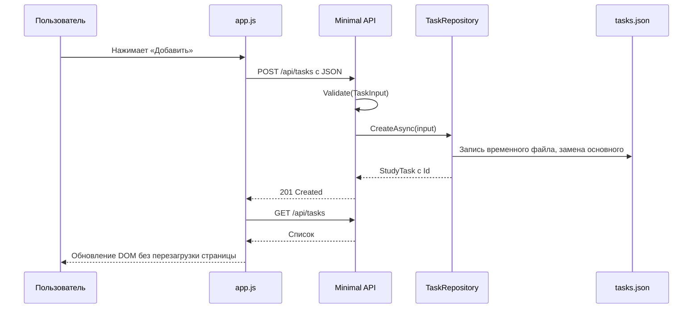

# StudyPlanner

Учебный планировщик задач на ASP.NET Core 10: Minimal API, HTML/CSS/JavaScript и отдельная страница Blazor. Предназначен для локального использования и демонстрации.

## Возможности

- Добавление, изменение, завершение и удаление задач.
- Предмет, срок, фильтр статуса и счётчики на главной странице.
- Фильтрация API по предмету и статусу, сортировка по сроку.
- Сохранение в `App_Data/tasks.json`; отдельная СУБД не требуется.
- Страница `/razor`: Blazor-компонент получает список через HTTP API.
- Middleware журналирует метод, путь, статус и длительность запроса.

## Скачать и запустить на Windows

1. Нажмите **Code → Download ZIP** на GitHub. Распакуйте архив целиком в доступную для записи папку, например `Документы\StudyPlanner`. Не запускайте файлы внутри ZIP.
2. Установите [.NET 10 SDK](https://dotnet.microsoft.com/download/dotnet/10.0) под архитектуру ПК. Нужен SDK; одного Runtime для сборки исходников недостаточно. Если установка запрещена, заранее обратитесь к преподавателю.
3. Откройте PowerShell в папке с `StudyPlanner.csproj`: откройте эту папку в Проводнике, введите `powershell` в адресной строке и нажмите Enter.
4. Выполните:

```powershell
dotnet --list-sdks
dotnet run --project StudyPlanner.csproj --no-launch-profile --urls http://127.0.0.1:5088
```

Первая команда показывает установленные SDK. Вторая собирает приложение и запускает локальный HTTP-сервер. Окно терминала оставьте открытым.

5. Откройте <http://127.0.0.1:5088>. API: <http://127.0.0.1:5088/api/tasks>, компонент: <http://127.0.0.1:5088/razor>.
6. Для завершения нажмите **Ctrl+C** в терминале. Записанные изменения остаются в `App_Data/tasks.json`.

Можно запустить `start.cmd` двойным щелчком после установки SDK. Git для скачивания ZIP не нужен. Для изучения достаточно VS Code; Visual Studio не обязательна.

## Карта кода

| Файл | Назначение |
|---|---|
| `Program.cs` | Создание сервера, DI, middleware, маршруты и серверная валидация |
| `Models/StudyTask.cs` | Неизменяемая запись задачи и входная модель `TaskInput` |
| `Services/TaskRepository.cs` | Общее хранилище, синхронизация запросов и сохранение JSON |
| `wwwroot/index.html` | Форма и разметка главной страницы |
| `wwwroot/app.js` | `fetch`, обработка кнопок, фильтр и обновление DOM |
| `wwwroot/app.css` | Оформление |
| `Components/Pages/TaskList.razor` | Компонент списка на C# с `InteractiveServer` |
| `Components/App.razor`, `Routes.razor` | Оболочка Blazor и маршрутизация компонентов |

## HTTP API

| Метод | Путь | Ответ |
|---|---|---|
| GET | `/api/tasks` | 200, массив задач |
| GET | `/api/tasks?subject=ASP.NET&completed=false` | 200, отфильтрованный массив |
| GET | `/api/tasks/{id}` | 200 или 404 |
| POST | `/api/tasks` | 201 с адресом созданной задачи; 400 при неверном вводе |
| PUT | `/api/tasks/{id}` | 200, 400 или 404 |
| DELETE | `/api/tasks/{id}` | 204 без тела или 404 |
| GET | `/api/stats` | 200, `total`, `completed`, `remaining` |

Пример тела POST/PUT:

```json
{"title":"Повторить маршрутизацию","subject":"ASP.NET","dueDate":"2026-12-07","isCompleted":false}
```

`Id` назначает сервер. `dueDate` может быть `null`. Название: 1–120 символов после обрезки пробелов; предмет: 1–80. PUT заменяет все изменяемые поля.

## Как проходит запрос



## Инструкция запуска

[Запуск на Windows и решение ошибок](docs/WINDOWS.md).

## Ограничения и состояние проверки

Учебный проект без аккаунтов, авторизации и разграничения доступа. Запускайте на `127.0.0.1`; в открытом Интернете его размещать нельзя. Публичный репозиторий содержит исходники, это не развёрнутый сервер.

JSON-хранилище рассчитано на один процесс. `SemaphoreSlim` защищает операции внутри процесса, не между несколькими серверами. Это не SQL и не полноценные транзакции СУБД. Файлу нужны права записи. При повреждении JSON приложение выдаст ошибку: сохраните копию файла и разберитесь с причиной; не удаляйте данные наугад.

До первой записи показываются две демонстрационные задачи; после успешного изменения сохраняется весь список. В публичный репозиторий пользовательский файл данных не включён.

Сборка ранее выполнена: 0 предупреждений, 0 ошибок. Запуск на Windows и работа интерфейса на ПК колледжа ещё не проверены. Наличие кода и успешная компиляция не заменяют такой прогон.

## Документация Microsoft

- [Minimal API](https://learn.microsoft.com/en-us/aspnet/core/tutorials/min-web-api?view=aspnetcore-10.0).
- [dotnet run](https://learn.microsoft.com/en-us/dotnet/core/tools/dotnet-run).
- [dotnet publish](https://learn.microsoft.com/en-us/dotnet/core/tools/dotnet-publish).
